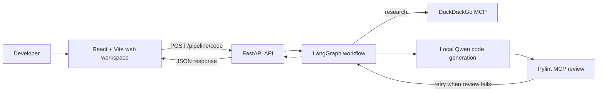

# CodePilot AI — Full-Stack Multi-Agent Coding Workspace

CodePilot AI is a full-stack developer workspace for submitting code-generation, research, and code-review requests to a multi-agent AI pipeline. The React web app provides the interactive workspace; a FastAPI/LangGraph service orchestrates the AI agents; and MCP services provide research and static-analysis tools.

This repository contains the frontend, backend API, and a Pylint MCP server implementation. The DuckDuckGo MCP server used for research is a separate service and must be supplied independently.

> **Scope:** This project generates and reviews code, then returns text to the caller. It does not execute generated code, edit a caller's repository, or provide a hosted coding workspace.

## Contents

- [Product overview](#product-overview)
- [Architecture](#architecture)
- [Repository layout](#repository-layout)
- [Requirements](#requirements)
- [Run the frontend](#run-the-frontend)
- [Configure the API](#configure-the-api)
- [Run locally](#run-locally)
- [Run the Pylint MCP server](#run-the-pylint-mcp-server)
- [API usage](#api-usage)
- [Persistence and operational notes](#persistence-and-operational-notes)
- [Tests](#tests)
- [Known limitations](#known-limitations)

## Product overview

The browser workspace lets a developer submit a coding, research, or review request, follow the pipeline's reported progress, and inspect the result. It includes request history stored in the browser, code-aware output rendering, copy/download actions, elapsed-time and request metadata, a configurable backend URL, and light/dark themes.

The frontend is a client for the API; it does not run the AI agents or execute generated code. Requests are sent to the backend's single pipeline endpoint. The backend routes them through specialized steps:

The API accepts a natural-language request and routes it through a graph of specialized steps:

1. **Classify** the request as a greeting, code request, research request, or code review request.
2. **Research**, when requested, by calling tools exposed by a DuckDuckGo MCP server.
3. **Generate Python code** with a locally loaded Qwen 2.5 Coder model and the repository's LoRA adapter.
4. **Review** code using the Pylint MCP service and an LLM-based review agent.
5. **Retry** generation when the review response indicates failure, up to the configured retry limit.

Greetings return a fixed response without invoking code generation. Review requests pass the submitted text to the review agent as Python source. Code and research workflows return the final generated/reviewed text through the API response envelope.

## Architecture

| Part | Technology | Role |
| --- | --- | --- |
| Web client | React 19, Vite, Tailwind CSS 4 | Developer workspace, request composer, pipeline/result views, and browser-local preferences/history. |
| HTTP API | FastAPI, Pydantic | Validates requests, checks bearer authentication, returns results and health checks. |
| Workflow | LangGraph | Routes requests between decision, research, code, and review nodes and manages review retries. |
| Code generation | Hugging Face Transformers, PEFT, Qwen2.5-Coder-0.5B-Instruct | Runs locally with the checked-in LoRA adapter. |
| Routing, research, review reasoning | LangChain, Groq | Performs request classification and agent reasoning using the configured Groq model. |
| Research tools | DuckDuckGo MCP endpoint | Supplies web-search tools to the research agent. This is configured as an external service. |
| Static analysis | Pylint MCP service | Exposes Python analysis tools to the review agent. An implementation is included in this repository. |
| Persistence | PostgreSQL, SQLAlchemy, LangGraph checkpointing | Stores application error logs and graph checkpoints in separate databases. |

The configured Groq model defaults to `openai/gpt-oss-120b`; the code-generation model defaults to `Qwen/Qwen2.5-Coder-0.5B-Instruct`. These serve different roles: Groq handles routing/reasoning while the local Qwen model generates Python code.



## Repository layout

```text
.
├── README.md
├── def/
│   └── agentic_code_pipeline.yaml    OpenAPI 3.0.3 description
├── frontend/
│   ├── src/                          React workspace, views, and API client
│   ├── package.json                  Vite scripts and frontend dependencies
│   └── CODEPILOT_AI_OVERVIEW.md       Frontend behavior and component overview
├── design/
│   ├── class.puml                    PlantUML class diagram
│   └── clientSequence.puml           PlantUML sequence diagram
├── code/
│   ├── src/                          FastAPI application and agents
│   ├── adapter/                      Local Qwen LoRA adapter and tokenizer files
│   ├── tests/                        Pipeline and local-model tests
│   ├── Dockerfile
│   ├── pyproject.toml
│   ├── uv.lock
│   ├── README.md                     Detailed API/runtime documentation
│   └── MODEL_AND_ARCHITECTURE.md     Model and architecture notes
└── pylint/
    └── pylint_mcp/                   Pylint MCP server implementation
```

The frontend, API, and Pylint MCP server are separate applications with their own setup. The API package and Python project configuration are under `code/`; run its commands from that directory. The Pylint MCP service is under `pylint/pylint_mcp/`.

## Requirements

- Python **3.14** (as declared in `code/pyproject.toml`) and [uv](https://docs.astral.sh/uv/), or Docker for the API container.
- Node.js and [pnpm](https://pnpm.io/) for the frontend (the repository includes `frontend/pnpm-lock.yaml`).
- PostgreSQL with two databases: an application database and a LangGraph checkpoint database.
- A Groq API key.
- Reachable DuckDuckGo and Pylint MCP endpoints using streamable HTTP.
- A bearer token of at least 32 characters.
- Network access to Hugging Face on first startup if the base Qwen model is not already cached. The base model is downloaded to the normal Transformers cache; the LoRA adapter is included under `code/adapter/`.

The local model can run on CPU, though generation may be slow. CUDA may be selected with `LOCAL_MODEL_DEVICE=auto` when available.

## Configure the API

From the repository root, create a local environment file from the example:

```powershell
Copy-Item code/src/.env.example code/src/.env
```

Edit `code/src/.env` with real values. Do not commit credentials or production `.env` files. The application loads this file for local development and also accepts environment variables in deployment.

| Variable | Purpose |
| --- | --- |
| `DB_HOST`, `DB_PORT`, `DB_USERNAME`, `DB_PASSWORD` | PostgreSQL connection settings shared by both databases. |
| `DB_NAME` | Application database used for error logs. |
| `DB_NAME_CHECKPOINT` | Database used by LangGraph's PostgreSQL checkpointer. |
| `API_AUTH_TOKEN` | Shared bearer credential; use a random secret with at least 32 characters. |
| `GROQ_API_KEY` | Groq API credential. |
| `GROQ_MODEL` | Model for routing, research, and review reasoning (default: `openai/gpt-oss-120b`). |
| `LOCAL_MODEL_BASE` | Hugging Face base model (default: `Qwen/Qwen2.5-Coder-0.5B-Instruct`). |
| `LOCAL_MODEL_ADAPTER` | Adapter path, relative to `code/` by default (`adapter`). |
| `LOCAL_MODEL_DEVICE` | Inference device (default: `cpu`; `auto` selects CUDA when available). |
| `LOCAL_MODEL_MAX_NEW_TOKENS` | Generation token limit (default: `768`). |
| `LOCAL_MODEL_TIMEOUT` | Generation timeout in seconds (default: `180`). |
| `DUCK_DUCK_GO` | DuckDuckGo MCP streamable HTTP URL. |
| `PYLINT_MCP_SERVER_URL` | Pylint MCP streamable HTTP URL. |
| `PYLINT_WORKSPACE` | Temporary review workspace accessible to the API and Pylint MCP service. |
| `HOST`, `PORT` | API bind address and port (defaults: `0.0.0.0`, `8080`). |
| `CORS_ORIGINS` | Comma-separated browser origins; empty disables CORS. |
| `LOG_LEVEL` | Logging verbosity (default: `INFO`). |

Generate a suitable API token with Python:

```sh
python -c "import secrets; print(secrets.token_urlsafe(48))"
```

`code/src/.env.example` contains the full set of example settings. The API validates required configuration and initializes database schemas at startup; it does not verify external model/MCP reachability until those integrations are used.

## Run the frontend

In a separate terminal, from `frontend/`:

```sh
pnpm install --frozen-lockfile
pnpm dev
```

Vite serves the workspace at `http://localhost:3000`. Configure the API address with `VITE_API_BASE_URL`; it defaults to `http://localhost:8000/api/v1/agentic`, so set it to match the backend address (for example `http://localhost:8080/api/v1/agentic` when running the API command below). The Settings screen also lets a user change the backend URL, which is saved in browser local storage.

The frontend reads an optional `VITE_API_AUTH_TOKEN` at build time and sends it as a bearer token. Vite-prefixed values are included in browser-delivered code; do not put a production secret in a publicly distributed frontend build. For a public deployment, place authentication behind a trusted server-side proxy or use an appropriate user authentication design. If serving the frontend and API from different origins, configure the backend's `CORS_ORIGINS` to include the frontend origin.

Create a local frontend env file from the example:

```sh
cp .env.example .env.local
```

Then adjust `VITE_API_BASE_URL` in `frontend/.env.local` if the backend is running somewhere else. `VITE_API_AUTH_TOKEN` can stay empty when the backend is configured without a browser-injected token; otherwise set it only for local development.

Build a static production bundle with:

```sh
pnpm build
```

The generated assets are written to `frontend/dist/`. `pnpm preview` can serve the built app locally for a production-build check.

## Run locally

Provision both PostgreSQL databases and start the configured MCP services first. Then, from the `code/` directory:

```sh
uv sync --no-install-project
uv run uvicorn src.main:app --host 127.0.0.1 --port 8080
```

On first startup, the application loads the local adapter and may download the Qwen base model. The API is available at `http://127.0.0.1:8080`. FastAPI's OpenAPI endpoints are available at `/docs` and `/openapi.json` while the service is running.

The Dockerfile is also in `code/`; build and run it from that directory:

```sh
cd code
docker build -t multiagent-code-pipeline .
docker run --rm -p 8080:8080 --env-file deployment.env multiagent-code-pipeline
```

Supply secrets via the deployment environment or a local, untracked env file. The image runs as an unprivileged user. Configure health probes to use `/health/live` and `/health/ready` as appropriate.

## Run the Pylint MCP server

The included service is a separate application. Review its [README](pylint/pylint_mcp/README.md) and `.env.example` for its tools and configuration. A typical local setup is:

```sh
cd pylint/pylint_mcp
uv sync
uv run fastapi dev src/main.py
```

Configure the API's `PYLINT_MCP_SERVER_URL` to the service's MCP endpoint. The Pylint service must be able to read the temporary Python file created by the API. When the services run in separate containers, mount the same private workspace volume at the same path in both containers and set `PYLINT_WORKSPACE` accordingly. The DuckDuckGo MCP server is not included here and must be supplied separately if research routing is used.

## API usage

### Generate code or request research

```http
POST /api/v1/agentic/pipeline/code
Authorization: Bearer <API_AUTH_TOKEN>
Content-Type: application/json
```

```json
{
  "user_query": "Write a Python function to add two numbers",
  "user_id": "example-user"
}
```

Example using `curl`:

```sh
curl -X POST http://localhost:8080/api/v1/agentic/pipeline/code \
  -H "Authorization: Bearer $API_AUTH_TOKEN" \
  -H "Content-Type: application/json" \
  -d '{"user_query":"Write a Python function to add two numbers","user_id":"example-user"}'
```

Both fields are required non-empty strings. `user_id` selects the LangGraph checkpoint thread; it is not an account identity or an authentication credential.

Example successful response:

```json
{
  "status_code": 200,
  "status": "success",
  "message": "Chatbot response generated",
  "data": {
    "output": "def add(a: int, b: int) -> int:\n    return a + b",
    "timestamp": "<UTC timestamp>"
  },
  "request_id": "<request UUID>"
}
```

### Health checks

| Endpoint | Behavior |
| --- | --- |
| `GET /health/live` | Confirms the process can respond. Does not check dependencies. |
| `GET /health/ready` | Checks connectivity to the application PostgreSQL database. Does not check the checkpoint DB, Groq, or MCP services. |

Both health endpoints are unauthenticated. See the detailed [API/runtime README](code/README.md) for response codes, configuration details, deployment guidance, and request lifecycle behavior.

The OpenAPI contract is also checked into [`def/agentic_code_pipeline.yaml`](def/agentic_code_pipeline.yaml).

## Persistence and operational notes

- `DB_NAME` stores application error records in `error_logs`; `DB_NAME_CHECKPOINT` stores LangGraph checkpoints. Both databases must exist, and the configured database user needs the privileges required to create tables and indexes.
- Each request starts with a fresh state object. A shared `user_id` thread ID does not, by itself, add prior messages to the model prompt as conversational memory.
- Review results are interpreted by checking whether the review response contains the word `fail` (case-insensitive). The API does not parse a structured score or return a separate review object/retry count.
- The code review path writes submitted text to a temporary `.py` file so the Pylint MCP service can inspect it. Keep the shared workspace private and make it writable by the API and readable by the MCP service.
- A request can include several sequential model and MCP calls and up to three review attempts. Set client and ingress timeouts accordingly; the endpoint does not stream intermediate progress.
- The single bearer token is checked for API access but does not provide user-specific permissions, scopes, or account management. Deploy behind TLS and restrict network access. Configure CORS only for trusted browser origins.

## Tests

The API tests mock external model and service calls. From `code/`:

```sh
uv sync --extra test --no-install-project
uv run pytest
```

End-to-end use still requires PostgreSQL, Groq credentials, and reachable MCP services. The checked-in diagrams are in `design/` and can be rendered with PlantUML.

## Known limitations

- Python code generation relies on local model inference and may be slow on CPU.
- Research and static review depend on external MCP services; the DuckDuckGo service is not included in this repository.
- The review agent's text-based pass/fail detection is less reliable than a structured review result.
- The service returns generated code but does not run it. Static analysis is not a guarantee of correctness, security, or suitability for production.
- Authentication uses one shared bearer token; there is no user account system or per-user authorization.

## Additional documentation

- [Detailed API and deployment notes](code/README.md)
- [Model and architecture notes](code/MODEL_AND_ARCHITECTURE.md)
- [Pylint MCP server](pylint/pylint_mcp/README.md)
- [OpenAPI specification](def/agentic_code_pipeline.yaml)
